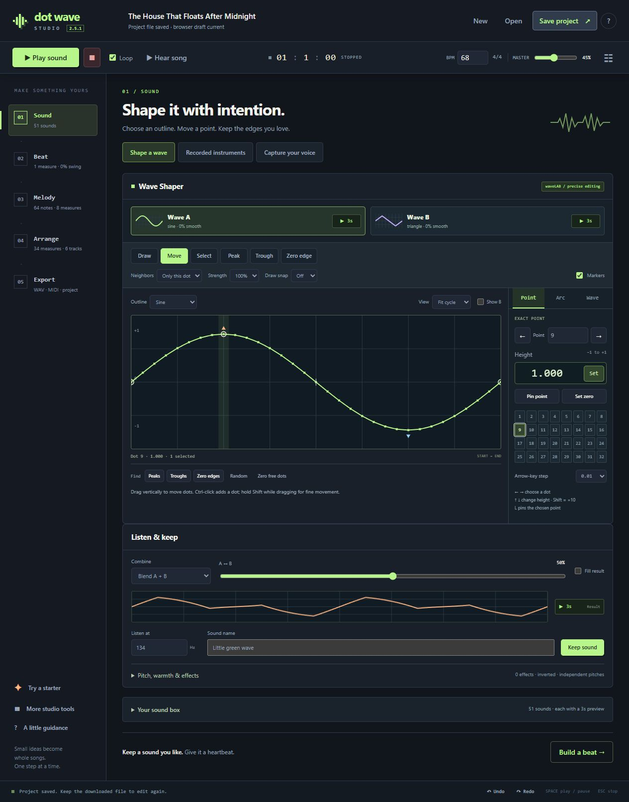

# Dot Wave Studio

A small, playful music studio: **Sound → Beat → Melody → Arrange → Export**.

## Run it

Download [Dot Wave Studio 2.5.1](releases/Dot-Wave-Studio-2.5.1.html), then open that HTML file in a browser. The guided studio and recorded instrument bank work offline.

For development, install Node.js 24 or newer. No dependency installation is needed:

```sh
node verify.cjs
node build.cjs
node serve.cjs
```

Open the local URL printed by the server. The build writes self-contained HTML files to `dist/`. `npm test`, `npm run build` and `npm start` are equivalent shortcuts.

## Wave Shaper

One editing graph, Wave A/B tabs, and focused **Point**, **Arc**, and **Wave** controls. Set exact heights, pin anchors, draw with adjustable strength and snapping, zoom into a cycle, bend selected arcs, and compare the two outlines. Both displayed ends share a single point. Each source and every saved sound has a three-second preview.

Version 2.5.1 groups a held arrow-key nudge into one Undo edit, restores graph focus after Undo/Redo, prevents an empty selection from targeting the entire wave, ignores unchanged height entries, and keeps save feedback in the status bar.



See [Wave Shaper controls](Wave-Shaper-guide.md) and the [studio guide](START-HERE.md).

## Music tools

- Draw and sculpt cyclic waveforms, blend or collide A/B, and keep reusable sounds.
- Use ten recorded instruments, with 39 included pitch anchors.
- Capture and review 15 vowel and 24 consonant samples locally; microphone permission is requested only when recording.
- Paint editable melodies, keep reusable patterns, and arrange independent clip placements.
- Fit the whole song, name sections, audition or loop a section, and mix level, balance and room ambience.
- Export WAV, MIDI, project files, stems and music handoff ZIPs.

## Verification and source

The test suite currently contains [64 checks](reports/verification-2.5.1.json). It covers audio/file formats, existing-project migration, voice-controller cancellation, waveform editing, pins, section rendering, solo/export separation, live audio replacement, held-key Undo grouping and keyboard focus restoration. Browser checks are recorded separately; passing automated checks does not verify physical microphone, speaker or touch-device quality.

The source is modular JavaScript/CSS. Audio, UI and validation share the same core models; the browser audio worker uses the same renderer as the tests. See [development notes](DEVELOPMENT.md).

Recorded instrument samples are credited under CC BY 3.0 in [sample credits](sample-credits/README.txt). Original source provenance and license text are included. Other third-party notices are in [Third-party-notices.txt](Third-party-notices.txt).

## Project storage

This private repository contains the program, build tools, migration/test fixtures and example music. Live browser drafts, personal voice banks and working-session exports are kept outside version control. Keep a downloaded Studio project or voice-bank file as a backup of your own work.

This repository is the development home for the downloadable edition. The existing itch.io page and its browser/demo release are managed separately.
